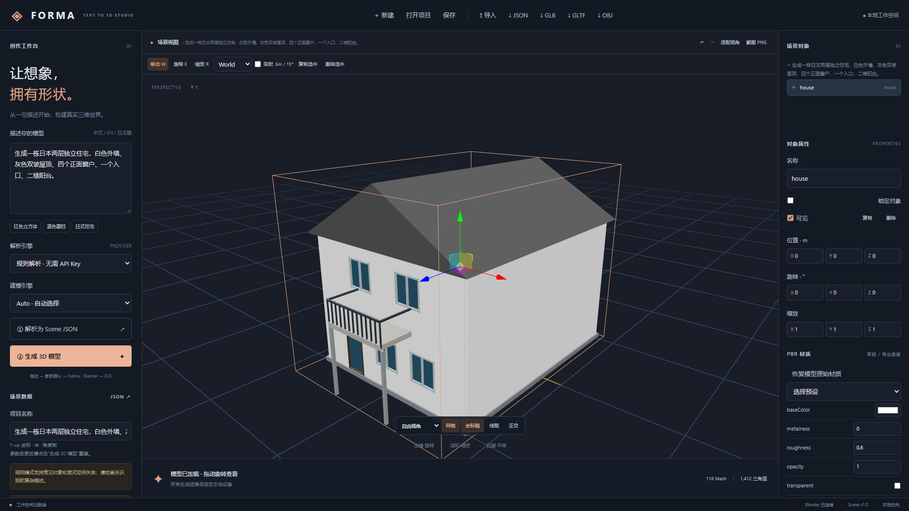

# 本次实现与验证报告

日期：2026-11-06（日本时间）。交付为可运行的首版，不宣称所有商业产品要求均已完成。

## 已实现

| 阶段 | 实际内容 |
| --- | --- |
| Phase 1 | Vite / React / TypeScript / Tailwind、FastAPI、健康检查、依赖、中文深色工作台、启动脚本 |
| Phase 2 | GLB / 内嵌 GLTF / OBJ 查看、OrbitControls、自动适配、透视与正交、六类视角、网格、坐标轴、线框、PNG 截图、加载错误边界 |
| Phase 3 | Blender 真实 Mesh；参数房屋、独立墙体、正面真实开口与窗框、门框、四种屋顶、阳台板与护栏、台阶、简化车库与院子；六种基础几何、五种多部件家具；GLB / OBJ / MTL 导出 |
| Phase 4 | 规则三语关键词解析、Scene JSON 严格范围验证、JSON 预览编辑、异步任务状态、有界队列、独立输出目录、真实端到端流程 |
| Phase 5 | 对象树及高亮、变换编辑、源参数编辑重建、复制 / 删除 / 可见性、30 步撤销重做、SQLite 项目 / 资产 / 历史、模型关联、项目重新打开、JSON 导入导出 |
| Phase 6 | 统一 Provider 入口、OpenAI-compatible 与 Ollama HTTP 适配、统一输出验证；前端可选择 Provider，服务配置通过环境变量 |
| Phase 7 | 单元 / API / Blender / 浏览器测试、GitHub Actions、文档及示例模型、文件和输入边界校验 |

示例 `examples/japanese-house.glb` 为实际 Blender 4.5.3 输出：118 个 Mesh、942 个顶点、1,412 个三角面、10 个复用材质。模型包含四个正面窗户。立方体与圆柱体也提供实际 GLB、OBJ 和材质文件。

## 实际测试结果

- Python pytest：**40 passed**，包含真实 Blender headless 集成，没有 Blender 跳过项。
- 前端 Vitest：**3 passed**，状态撤销 / 重做、API 参数传递、服务错误传播。
- Playwright：**3 passed**，真实立方体生成加载下载、错误流程、日式住宅生成及 GLB 重新导入。视觉回归检查读取 WebGL 画布，确认大量真实模型像素已绘制，避免仅依据“加载完成”状态误判。
- TypeScript 与 Vite 生产构建：通过。Three.js 依赖导致主 bundle 约 1.21 MB（gzip 约 340 KB），有体积提示，尚未进一步拆包。
- npm audit（生产依赖）：0 vulnerabilities；升级测试工具后全量安装审计也为 0。
- Python 测试出现一项 Starlette 关于未来 httpx2 测试客户端迁移的弃用提示，不影响当前测试。

真实建模测试覆盖四种屋顶与红色屋顶材质、全部基础几何及家具、GLB Mesh / 顶点 / 材质存在性、圆柱高度和房屋尺寸；GLB 通过 Blender 重新导入，核对 Mesh 数量、包围盒与材质数量。LLM 适配器未使用真实 API Key 或本地 Ollama 模型联网验收，不能将其列为已通过的真实服务测试。

测试命令及前提见 README。无 Blender 的其他机器或 CI 会明确标注集成跳过，不能套用此工作区的通过结论。

## 未完成与简化范围

- 不是任意自然语言生成任意形状的通用神经 3D 引擎；规则模式只处理列出的常见对象，复杂意图需人工检查。相对位置、否定、复杂数量组合及跨语言表达覆盖有限；组合对象采用简单间距布局。
- 参数化风格细分、真实内部结构、完整车库内部、阳台通门、完整室内楼梯与建造级模型未实现。四坡是简化金字塔屋顶。
- 尚无专业材质编辑器、PBR 贴图、GLTF 外部文件包 / OBJ MTL 组合导入、GLTF 导出；外部模型主要用于查看，不反推参数。
- 没有 TransformControls 拖动手柄、外部模型通用对象属性恢复、视图编辑直接导出。源参数与视图变换需要重建后写入下载文件。
- Provider 连接地址和密钥尚无设置页面；英文、日文 UI 翻译字典尚未实现。解析语言支持不等于全界面国际化。
- SQLite 中 Scene / Object 作为项目 JSON 聚合存储，未独立规范化建表。
- 尚无取消任务、操作系统内存沙箱、磁盘配额回收、持久化重试调度、多后端 worker、身份验证、Windows 安装包或商店发布。
- Future3DProvider 仅明确返回“尚未实现”。Hunyuan3D / Tripo / Meshy 等服务不伪造实现。

安全边界和下一版本顺序详见 ARCHITECTURE.md。
