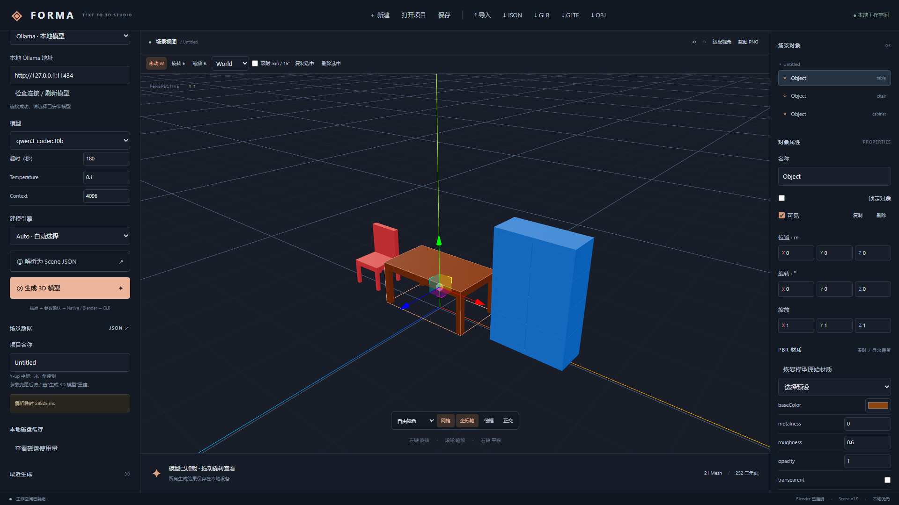

# V0.2.0 实现报告

日期：2026-11-06（Asia/Tokyo）。基线：d5ec982d18958763b5724f52e0bb531d26efe3bb。开发分支：codex/v0.2-studio；按用户最新明确授权，将验证后的提交快进到 main 并推送。

## Milestone 完成情况

| 阶段 | 实际交付 |
| --- | --- |
| A | Native 六种几何、五种多部件家具、稳定 ID、父子变换、资源释放、Auto / Native / Blender 选择、GLB 导出 |
| B | TransformControls 移动 / 旋转 / 缩放、Local / World、吸附、基础多选、复制 / 隐藏 / 锁定 / 删除、快捷键、拖拽事务撤销、当前场景 GLB / GLTF / OBJ+MTL / JSON / PNG 导出 |
| C | Ollama 连通性、模型查询 / 选择、超时 / temperature / context、回环地址限制、cloud 模型拒绝、JSON 错误提示、耗时；逐对象规则参数与声明式空间关系、AABB 求解 |
| D | 四面墙独立开口、楼层 / 尺寸 / 位置验证、阳台方位和偏移、带屋脊四坡屋顶、sRGB 材质修正、PBR 编辑及预设、兼容旧参数 |
| E | 实际取消与进程树终止、失败日志及产物回收、磁盘软配额与项目引用保护、保存当前 GLB 快照、组件拆分、快速 / Blender / live 测试分离、文档和 CI |

## 验证记录

| 检查 | 实测结果 |
| --- | --- |
| Python 常规 + Blender | **57 passed，1 live 测试被明确排除**；包含原有全部 V0.1 回归、四面开口、材质与 GLB 往返、实际子进程树取消、项目引用保护 |
| Python 真实 Ollama（独立运行） | **1 passed，57 deselected**，最终版本使用本地 qwen3-coder:30b，约 26.82 秒 |
| Vitest | **23 passed**，Native 全类型、尺寸 / 颜色 / 父子矩阵、引擎选择、事务撤销、复制 / 删除 / 锁定、材质恢复、资源释放、隐藏模型快照保留、API |
| Playwright 默认套件 | **5 passed，1 live 测试按默认条件跳过**；真实鼠标拖拽及导出坐标、无 Blender Native、GLB 变换 / PBR / 包围盒往返、真实 Blender 房屋与材质导出 |
| Playwright 真实 Ollama（单独显式运行） | **1 passed**，本地服务检查、模型选择、原始中文描述解析、三对象颜色与左右关系、Native Mesh 显示；约 32.4 秒 |
| TypeScript / Vite | 构建通过；主 bundle 约 1.31 MB / gzip 369 KB，仍有体积提示 |
| npm audit | **0 vulnerabilities** |
| 共享 Schema / 示例 | Pydantic 与共享 JSON Schema 一致；所有示例 Scene 验证通过 |

CI 工作流已更新，但本次未在 GitHub 上运行。Python 保留一项 Starlette 测试客户端未来迁移 httpx2 的弃用提示。跳过项不计入通过项；真实 LLM 单独实测，不使用 Mock 结果替代。

已执行的实际场景包含：无需 Blender 的 Native 立方体、真实鼠标拖拽后导出 GLB 并校验变换、PBR 与包围盒往返一致性、真实 Blender 房屋回归、左墙窗户位移、四种屋顶、取消时终止子进程、清理时保护项目引用资产。

本机现有 Ollama 0.33.3 / qwen3-coder:30b CPU 模型已完成真实 Provider 和浏览器验证，使用 OLLAMA_NO_CLOUD=1，不下载模型。独立推理记录保存在 `ollama-live-result.json`，最终浏览器生成的场景在 `examples/ollama-room.json`，截图见下。第一次语义检查发现默认值被滥用，修复显式字段约束后重新验证；首次尝试不计为通过。开发期间受热更新干扰的中断运行不计为成功；冻结代码后重新运行的真实流程通过。最终常规浏览器回归改用独立 5174 端口、忽略测试产物热更新，5 项全部通过。

## 兼容性与范围

V0.1 API、SQLite 项目、默认住宅参数及 Schema version 1.0 继续使用；新增可选字段补默认值。GLB 下载按钮改为当前场景导出，原始生成文件下载 API 保留。旧 windows / doors 在 facades 为 null 时保持旧布局。V0.1 完整测试继续运行，测试新增强断言而非删除旧验收。

Auto 对含房屋的混合场景整体选择 Blender；不做跨引擎部分生成。Native 不支持房屋或外部导入参数重建；外部模型仍可编辑和直接导出。规则解析对复杂语言和同类对象描述仍有限。四面墙开口目前为结构化 JSON 编辑器，不是可视化墙面拖放工具。

PBR 覆盖以 Scene 对象为单位，房屋整体材质覆盖会影响各部件；屋顶 / 墙体源颜色仍通过程序化参数重建，并可恢复原始材质。外部模型以包装节点进行基础交互，不反推构件语义。非均匀缩放父节点下的旋转 / 缩放手柄暂被禁用，请先统一父级缩放或使用属性栏编辑局部 TRS；其他不可表示的剪切操作也会明确拒绝。

## 修改文件分组

- `frontend/src/engines/native/`：生成器、材质、资源生命周期和几何测试。
- `frontend/src/viewer/`、`Viewer.tsx`：资产加载 / 同步、局部 / 世界矩阵、变换控件与选框。
- `frontend/src/services/export.ts`：统一快照、GLB / GLTF / OBJ / MTL。
- `frontend/src/components/`、`App.tsx`、`main.tsx`、`store.ts`、`types.ts`：工作台拆分、状态、PBR、Ollama、磁盘 UI、撤销与多选。
- `backend/app/schema.py`、`providers.py`、`ollama.py`、`spatial.py`：Schema 扩展、Provider、本地限制、关系求解。
- `backend/app/main.py`、`job_runtime.py`、`storage.py`：API、快照持久化、取消、日志与磁盘清理。
- `backend/blender/generate.py`：开口、屋顶、阳台、PBR 和颜色空间。
- 测试、共享 Schema、示例文件、包版本与 lockfile、README、架构、报告及 CI 随实现更新。

## 尚未完成与 V0.3

OS 硬资源配额和完整沙箱、用户认证 / 多进程调度、专业引擎、Windows 安装包、纹理图 / GLTF 文件包、完整动画、墙面可视化拖放和构件级材质编辑尚未实现。建议 V0.3 优先完善导入资源包与构件选择、精确空间碰撞、Windows Job Object 硬限额及桌面封装；随后扩展专业生成引擎。
