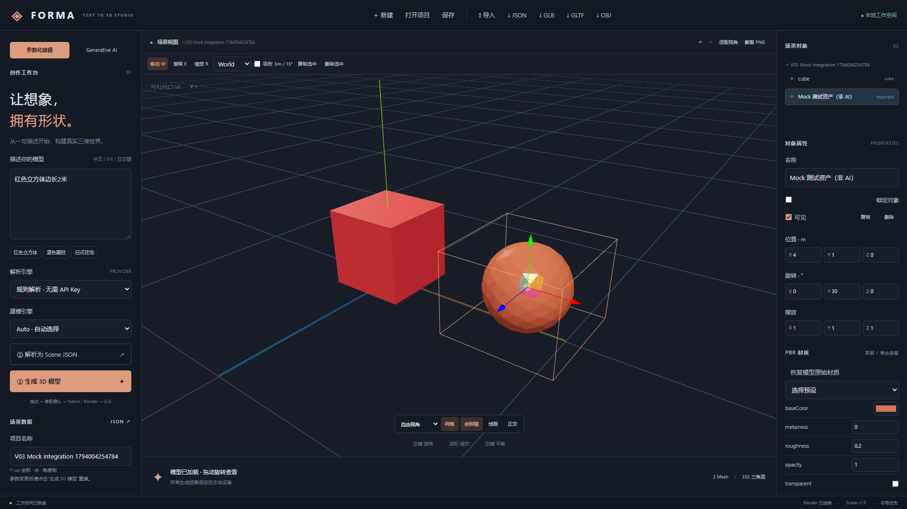

# V0.3.0 实现报告

日期：2026-11-06（Asia/Tokyo）。基线：`d0e0295a2832770893ebb8d6e734db6193a4b617`；独立分支：`codex/v0.3-generative-ai`。本次未合并或推送 main。V0.2 的实现记录保存在 [历史报告](IMPLEMENTATION-V02.md)。

## 交付与验收状态

| 阶段 | 交付 | 实际验证范围 |
| --- | --- | --- |
| A | Engine 契约、Hunyuan3D 2.1 官方接口与许可证核查、RAM/磁盘/GPU/Worker 诊断 | Passed；未测量项返回 Unknown，不把 Intel 共享内存当 CUDA 显存 |
| B | 独立回环认证 Worker、单任务执行队列、任务数据库、实际子进程取消/超时、重启回收 | Integration Passed，使用显式开启的 Mock 子进程；API 环境未安装 Torch |
| C | 本地 Shape 管线适配器、固定源码/权重版本和 SHA 校验、真实采样回调；独立可选 Paint 步骤 | **真实 Shape/Paint 未验证**，本机不满足 CUDA、依赖与权重条件 |
| D | 实际 GLB Mesh 校验、原始备份、坐标/尺寸处理、可选修复/减面、纹理保留、插入当前场景 | Mock/Integration Passed；测试几何不代表神经模型质量 |
| E | Generative UI、上传预览/确认、进度/取消/日志/历史、元数据、变换/材质编辑、项目保存 | 浏览器集成验证，见下方结果 |
| F | 可配置 OpenAI-compatible Text-to-Image b64_json 适配器、生成参考图、确认后请求 3D | HTTP 模拟服务契约 Passed；**未配置真实图像 Provider，真实文字到 3D 未验证** |
| G | 回归、分层测试、安装/诊断脚本、许可证/GPU 文档、轻量 CI 与可选 GPU CI | 本地验证见下；GitHub CI 尚未执行 |

## 测试记录

| 检查 | 结果 |
| --- | --- |
| Python 常规、Blender 与 Worker Mock 集成 | **81 passed，2 deselected**；排除 live LLM 与 real_ai |
| Vitest | **24 passed** |
| TypeScript / Vite | 生产构建通过；主 JS 约 1.32 MB / gzip 373 KB，仍有 bundle 体积提示 |
| Playwright | **7 passed，1 live Ollama 默认跳过** |
| npm audit | **0 vulnerabilities** |
| Real AI | 显式启用 RUN_HUNYUAN_REAL 后检查真实 Worker：**Skipped**；没有执行神经推理，没有生成真实 AI 样例 |
| 共享 Schema / 示例 / 脚本 | Pydantic Schema 一致，5 个 Scene 示例验证通过；Python 编译与 PowerShell 语法检查通过 |
| Text-to-Image 真实服务 / Paint | **Skipped / 未配置或未准备**，不计入通过 |

后端覆盖实际 PNG/JPEG/WebP 解码、EXIF 方向处理、大小/像素/损坏图片拒绝、回环与令牌限制、任务排队/取消、CPU 退化、HTTP 图像 Provider 契约、无效/非有限 Mesh 拒绝、纹理保留、项目引用/原图保护。Worker 集成启动实际隔离进程，通过 HTTP 读取模型和原始备份，再清理任务。旧版 Native、Blender、材质和持久化回归一并运行。

浏览器 Mock 场景为既有红色立方体追加橙色测试 Mesh，完成位置/旋转/粗糙度修改、SQLite 保存与重开、GLB 导出/再导入，并保留来源元数据。**Mock 几何不是根据图片生成的 AI 模型**。

## 修改清单

- `backend/app/ai3d/`：契约、图片、诊断、Mesh、Worker/图像适配器、任务/历史/素材 API。
- `ai_worker/`：独立服务、真实 Hunyuan 管线、环境探测、版本/哈希清单、独立依赖。
- 后端 main/schema/storage/job_runtime：路由与生命周期、兼容 Scene 1.0 的可选资产元数据、引用保护、可信子进程启动通知及凭证环境隔离。
- 前端 GenerativePanel/AssetInfo/insertAsset：生成工作区、明确的 Mock/真实来源、当前场景追加、项目保存和资产导出；复用现有 Viewer 与编辑器。
- `scripts/*ai3d*.ps1`：默认只诊断，独立 Python 3.10 环境、显式依赖安装、额外确认后才下载固定权重。
- 版本、依赖、共享 Schema、测试、CI、README、ARCHITECTURE、GPU-SETUP、MODEL-LICENSES、V03-CHECKLIST 与实际硬件报告。

## 本机限制与使用

本机检测到 Intel UHD，约 32 GB RAM；无可用 NVIDIA CUDA，未准备独立 ML Python、上游源码安装或模型权重。测试使用 API Python 启动轻量 Worker 的 Mock 模式，仅证明协议与编辑器闭环。没有安装 CUDA/显卡驱动，没有下载多 GB 权重，没有在 API 环境安装 PyTorch。详细实测数据见 [硬件报告](v03-hardware-diagnostics.json)。

真实推理需按 [GPU 安装文档](GPU-SETUP.md) 在支持的机器准备独立环境、可信本地源码与权重，再显式运行 real_ai 测试；本次不能宣称满足硬件时已实测成功。Paint 另需依赖、CUDA 扩展和纹理权重，Shape 可用不等于 Paint 可用。纹理、非流形质量和生成质量仍须在真实模型上验收。

Shape 官方权重为约 7.37 GB 的 ckpt，并非可直接假定存在的 safetensors；加载前核验固定 SHA，官方加载仍涉及可信代码/配置。许可证限制及源码头部差异见 [MODEL-LICENSES](MODEL-LICENSES.md)，不宣称无限制商用。

上传图片上限 10 MB/1600 万像素，规范化 PNG；嵌入纹理最多 4096² 像素，模型产物最多 50 MB。默认不做拓扑修复或减面，保留原始模型。任务/磁盘配额为应用级软限制；取消通过终止独立进程释放 GPU。大型模型内存峰值、真实 GPU 性能和高质量 PBR 仍待目标环境实测。

本机 CI 定义已更新，但没有推送执行远端 CI；Python 存在 Starlette/httpx 测试客户端弃用提示，前端存在包体积提示。跳过项与未执行项均未计入通过。

交付时正常服务已重启至最新代码，API 与轻量诊断 Worker 的 Mock 均恢复关闭。需要复跑 Mock 浏览器用例时，须按 GPU-SETUP 显式启用测试模式。
