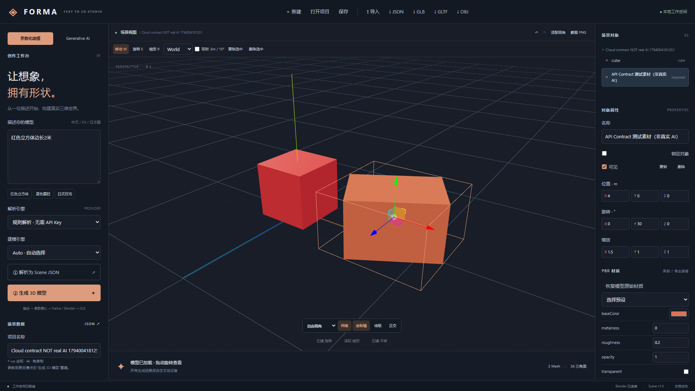

# V0.3.1 云端 Provider 实现与 V0.3 验收

日期：2026-11-07（Asia/Tokyo）。本次基线为 `ab2daf5`，独立开发分支 `codex/cloud-3d-provider`。核对 Git 后确认 V0.3 已经快进合并并推送至 main；用户描述中的“main 还是 V0.2”是旧状态，本次无需重复合并 V0.3。原报告保存在 [IMPLEMENTATION-V03](IMPLEMENTATION-V03.md)。

## 本次交付

- Meshy 官方云端 Adapter，同时支持文字和图片生成。文字默认 preview → refine 生成带纹理资产；图片直接提交 2K PBR 任务。无须本机 NVIDIA/CUDA，不下载大型模型。
- 保留 Hunyuan3D 与显式 Mock；Engine 注册表增加 meshy，云端编排独立复用现有 SQLite、资产登记、GLB 编辑器、项目保存和导出链路。
- Windows 当前用户 DPAPI 加密 API Key，仓库外存储；交互终端隐藏输入，无前端密钥输入或读取接口、无 localStorage、无命令行密钥参数。状态检查不发送密钥到前端，也不主动上传输入或调用收费任务。
- 明确的上传/费用与第三方条款确认，直接输入“生成一条红色、有翅膀的幻想龙。”；没有密钥时禁用生成，不用规则几何或 Mock 替代真实结果。
- 异步轮询、当前阶段进度、错误分类、Retry-After、有界 GET 重试，创建 POST 不自动重试；任务 ID 持久化、停止/重启后显式恢复。运行中不能云端中止，不宣称停止等待等于停止计费。refine 创建结果未知时禁止重复提交。
- 独立无认证 CDN 下载、固定 HTTPS 域名、逐重定向检查、50 MB 流式限额；实际 Mesh/图片/纹理校验、原始备份、非破坏根变换，保留原始 GLB buffer/材质/供应商元数据。插入后可修改材质/变换、保存、重开、导出及再导入。
- 更新版本 0.3.1、README、架构、GPU 路径、第三方商业使用与服务限制、云端配置/测试指南；CI 明确排除付费 real_api。

## 测试结果与分类

| 类型 | 实测结果 | 证明范围 |
| --- | --- | --- |
| V0.3 基线 Python | 81 passed，2 deselected | 原有 Native/Blender/持久化与轻量 Worker 测试；不含真实 GPU |
| 最终 Python 回归 | **106 passed，3 deselected** | 包含 25 项新增 Meshy/安全存储/GLB 契约验证；排除真实 LLM/GPU/付费 API |
| API Contract | **25 passed** | httpx MockTransport，真实 HTTP 请求序列与本地 GLB 处理，未发出真实生成请求 |
| Vitest | **24 passed** | 原有前端建模/编辑/导出回归 |
| TypeScript / Vite | **Passed** | 生产构建；bundle 约 1.33 MB / gzip 375 KB，仍有体积提示 |
| Playwright 最终串行回归 | **9 passed，1 live Ollama 默认跳过**（约 3 分钟） | Native、真实 Blender、Worker Mock、缺密钥阻止与云端 UI 契约 |
| 真实 Ollama Python | **1 passed，82 deselected**（72.06 秒） | 实际本地 qwen3-coder:30b，三对象颜色和相对位置 |
| 真实 Ollama 浏览器 | **1 passed**（34.9 秒） | 实际连接、中文描述、本地解析及 Native 模型展示 |
| npm audit | **0 vulnerabilities** | 本机依赖审计 |
| Meshy 公开端点连通性 | **HTTP 401** | 无认证、只读 GET，不发送描述/图片，不创建任务、不证明推理成功 |
| Real API Inference | **Skipped** | 没有配置真实 Meshy API Key；没有付费生成、真实龙模型或质量验证 |
| Real Hunyuan Shape/Paint | **Skipped / unavailable** | 本机仍无 NVIDIA CUDA、AI 依赖和权重，未执行真实神经推理 |

契约测试覆盖：费用/条款确认前不提交、缺密钥明确阻止、文字 preview/refine 参数、图片 data URI 与最小尺寸、401/402/403/429/500、安全错误不回显密钥、POST 超时不重试、取消竞态、停止后恢复不重复创建、重启不删除/重建收费任务、refine 不确定性保护、CDN/重定向/认证隔离、无效 GLB 不替换、几何/材质/标记保留、Windows DPAPI 实际加密往返。

浏览器云端流程使用**明确标注的 API Contract 测试素材（非真实 AI）**，真实执行 Three.js 加载、位置/旋转/缩放/粗糙度编辑、SQLite 保存、重载打开、GLB 导出/再导入及来源元数据断言。该测试并不证明 Meshy 生成了龙。截图见下：

首次 V0.3 浏览器验收出现异步状态等待超时，真实 Ollama 首次因服务未启动失败；启动已有本地服务后真实 Python/浏览器均通过。后续并发回归时 Ollama 模型驻留使可用内存约 4 GB，多项浏览器等待超时；本次测试模型卸载后约 19.7 GB 可用，改为串行冻结代码重跑。失败/中断尝试不计为通过。硬件诊断本身再次实测耗时约 1.23 秒且明确 Hunyuan unavailable。Python 仍存在 Starlette/httpx 测试客户端弃用提示。

## 主要文件

| 区域 | 修改 |
| --- | --- |
| 后端新增 | ai3d/meshy.py、cloud.py、cloud_mesh.py、credentials.py |
| 后端增量 | Engine 注册表、CloudRequest、可空源图/云端来源登记、路由与版本、测试标记 |
| 前端 | CloudGenerationPanel、原生成面板入口、进度/远端 ID 类型、供应商 GLB asset 元数据导出保留 |
| 测试 | test_meshy.py、cloud.spec.ts、原 Generative 异步诊断/上传响应与 Worker 就绪等待窗口 |
| 配置/文档 | configure-meshy.ps1、gitignore、轻量 CI、CLOUD-PROVIDERS、第三方许可、README、架构、GPU 文档、验收清单与报告 |

## 尚未验证和边界

1. 当前真实 API Key 缺失，未验证账户权限、余额、云端推理/纹理质量、实际生成耗时、真实供应商 GLB 在本机的完整往返。官方文档核查和未认证 401 不计为真实推理通过。
2. 真实付费测试默认跳过，需要用户自己安全配置密钥并显式接受费用。参见 [配置与测试](CLOUD-PROVIDERS.md)。服务生成的复杂度、红色外观与“有翅膀的幻想龙”语义质量须用真实请求验收。
3. Meshy 仅实现文档化的 GLB 输出。不为不存在 GLB 的结果伪造转换，不做额外收费的格式转换；不支持超 50 MB 文件。CDN/模型协议变化会明确失败；未知扩展、动画/骨骼、DRACO 与厂商特殊标记的完整支持仍需真实资产测试。
4. 密钥存储目前为 Windows DPAPI，其他系统 fail closed。应用是可信本机单用户客户端，不是共享密钥的多用户 SaaS；转售或白标服务需另外核对供应商许可。Meshy 的输出不继承项目 MIT。
5. 新云端工作无需本地 Worker，但不代表本地 Hunyuan 被验证。GPU/权重状态未变，未下载多 GB 模型、未安装 CUDA 或显卡驱动。
6. 本地测试通过不等于远端 GitHub CI 已通过，CI 需推送后单独确认。

最终浏览器冻结代码串行套件 9 项全部通过（含实际 Mock Worker 传回 Mesh）；已完成 Schema/Scene 示例、Python 编译、PowerShell 语法和 Git diff 空白检查。正常预览服务恢复 Mock 关闭，付费生成仍需用户自己配置密钥。
